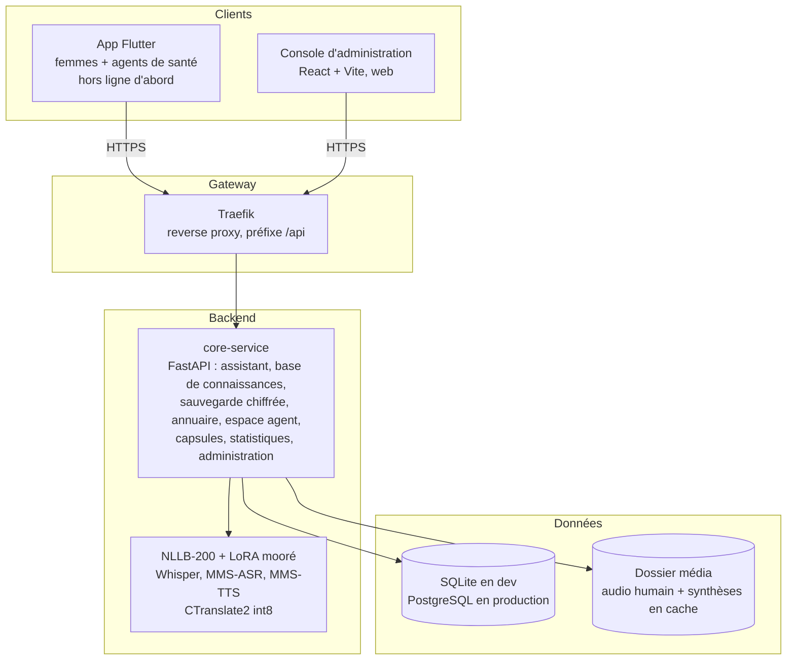

# Architecture — Laafi Ma

Vue d'ensemble technique de Laafi Ma, application vocale de santé et de
protection pour les femmes du Burkina Faso, en français, mooré et dioula.
Le contrat exact de l'API (chemins, champs, codes, rôles, règles de
confidentialité) est dans [`API.md`](API.md) : c'est la référence commune
du backend, de l'app Flutter et de la console d'administration.

## Schéma général



Un seul service applicatif : `core-service`. Les services hérités de Trad IA
(clonage vocal, notifications, worker vidéo, Redis) ont été retirés — aucune
fonctionnalité de Laafi Ma n'en a besoin, et chaque service Python+IA
supplémentaire coûte des centaines de Mo de mémoire sur une machine à 8 Go.

En local sans Docker, Traefik est omis : l'app et la console appellent
directement `http://127.0.0.1:8000`. Tout se démarre avec
[`scripts/dev.ps1`](../scripts/dev.ps1) (`-NoModels` pour démarrer l'API sans
charger les modèles d'IA).

## Rôles

| Rôle | Qui | Accès |
|---|---|---|
| `woman` | Utilisatrice de l'app, compte ANONYME (ni nom, ni téléphone, ni email) | Sa sauvegarde chiffrée uniquement |
| `agent` | Agent de santé communautaire (ASBC) | Espace agent (ses propres fiches), traduction vocale |
| `validator` | Sage-femme, médecin | Base de connaissances, signes de danger, capsules, validation |
| `admin` | Équipe Ztech | Comptes du personnel, annuaire, districts, statistiques, + tout ce que fait un validateur |

Une femme n'a jamais besoin de compte : l'app fonctionne entièrement hors
ligne. Le compte "appareil" (`POST /auth/device`) n'existe que pour la
sauvegarde chiffrée facultative ; il se récupère avec un code de récupération
montré une seule fois et stocké haché.

Le premier admin est créé par `python -m app.bootstrap_admin` (emails de
`ADMIN_EMAILS`, mot de passe lu dans `ADMIN_BOOTSTRAP_PASSWORD` ou demandé au
clavier). Les autres comptes du personnel sont créés depuis la console, avec
un mot de passe temporaire montré une seule fois ; pas de réinitialisation par
email, c'est un admin qui en génère un nouveau.

## Règles de confidentialité et où elles sont appliquées

| Règle (API.md) | Mise en œuvre |
|---|---|
| 1. Carnet de santé jamais en clair | Chiffrement AES-256-GCM sur l'appareil ; `record_backups` ne stocke que le blob base64 tel quel (`routers/records.py`) |
| 2. Événements sans identifiant | `event_counts` = compteurs journaliers (jour, type, langue, district) : ni ligne par événement, ni compte, ni appareil, ni IP, ni heure (`routers/events.py`) |
| 3. Petites cellules supprimées | `GET /public/stats` retire toute cellule < `PUBLIC_STATS_MIN_COUNT` ; `help_*` et `danger_flagged` jamais par district ni par semaine |
| 4. Orientations VBG anonymes | La table `gbv_referrals` n'a aucune colonne de nom ni de bénéficiaire |
| 5. Seul le contenu validé est servi | L'assistant, la FAQ, les signes de danger publics, les capsules publiques et la synthèse vocale ne lisent que `status = validated` |

Les comptes `woman` ne sont jamais listés ni manipulables individuellement
dans la console (`GET /admin/users` les exclut) : l'admin n'en voit que le
nombre.

## Flux principaux

**Question à l'assistant** (`/assistant/ask-text`, `/assistant/ask-voice`) :

```
voix (fr/mos/dyu) --Whisper ou MMS-ASR--> texte --NLLB (pivot anglais pour le mooré)--> français
    --rapprochement TF-IDF n-grammes--> entrée VALIDÉE --> réponse dans la langue demandée
    \--mots-clés des signes de danger VALIDÉS--> alerte "allez au centre de santé"
```

Le rapprochement (`app/matching.py`) est en pur Python, sans modèle : texte
normalisé (minuscules, sans accents, sans mots vides), similarité cosinus
TF-IDF sur des n-grammes de caractères avec la question française et ses
variantes. Sous `ASSISTANT_MIN_CONFIDENCE`, la question est enregistrée
anonymement dans `unanswered_questions` pour les validateurs, et l'app reçoit
« Demandez à votre agent de santé ». La détection des signes de danger est
indépendante du rapprochement. `ask-text` en français fonctionne sans aucun
modèle chargé. Rien n'est jamais généré : la réponse est toujours un texte
relu par un professionnel de santé.

`/assistant/transcribe` ne fait que la première étape (voix -> texte, et sa
traduction française) : l'app s'en sert pour faire confirmer la question, ou
pour comparer SUR L'APPAREIL la transcription à la phrase d'aide secrète.
Rien n'y est enregistré (ni question sans réponse, ni événement).

**Audio des réponses et des capsules** : un enregistrement humain s'il
existe (`/kb/entries/{id}/audio/{lang}`), sinon une synthèse MMS-TTS générée
à la PREMIÈRE lecture de `/media/<kind>/tts/<id>_<langue>_<empreinte>.wav`
puis mise en cache sur disque. L'empreinte du texte fait partie du nom : un
texte modifié change d'URL, et l'ancienne URL répond 404 (jamais un audio
périmé).

**Circuit de validation** : `draft` → `validated` → `archived`. Toute
modification (texte, mots-clés, audio, traduction automatique) renvoie le
contenu en `draft`. `POST /kb/entries/{id}/translate` remplit le mooré et le
dioula manquants par traduction automatique, marqués `machine_translated`
jusqu'à leur relecture.

**Espace agent hors ligne** : les identifiants sont des UUID créés sur
l'appareil ; `POST /agent/sync` applique le dernier-écrit-gagne sur
`updated_at` (horloge de l'appareil), avec suppression logique, et renvoie ce
qui a changé depuis `since` mesuré sur `synced_at` (horloge du serveur). Tout
est cloisonné par agent.

**Traduction pour les agents** (`/translate`, `/translate-voice`...) : reprise
de Trad IA. Moteur `verified` (NLLB + LoRA mooré, relu par un locuteur natif)
par défaut, `fast` (CTranslate2 int8, 7 à 20 fois plus rapide, pas encore
relu) seulement sur demande explicite ; la réponse dit toujours quel moteur a
traduit.

## Code (`backend/services/core-service/app/`)

| Fichier | Rôle |
|---|---|
| `main.py` | Assemble l'application (middlewares, métriques, routeurs) |
| `routers/` | Un routeur par module : `auth`, `assistant`, `kb`, `records`, `help`, `agent`, `translation`, `learn`, `districts`, `events`, `admin`, `meta` (santé, langues, `/media`) |
| `schemas/` | Schémas Pydantic des requêtes/réponses |
| `db_models.py` / `db_types.py` / `db.py` | Tables SQLAlchemy, dates UTC, connexion |
| `content.py` | Conversion des contenus de santé et règle "modification = brouillon" |
| `matching.py` | Normalisation, rapprochement, mots-clés de danger |
| `audio_store.py` / `uploads.py` / `media_service.py` | Fichiers audio, lecture sûre des envois, décodage ffmpeg |
| `translation_service.py` / `fast_translation_service.py` / `speech_service.py` | Modèles d'IA (chargés paresseusement, jamais dans les tests) |
| `seed.py` / `bootstrap_admin.py` | Données sourcées de départ, premier admin |

## Langues et modèles d'IA

| Besoin | Modèle | Langues |
|---|---|---|
| Traduction | NLLB-200 (600M, distillé) | fr ↔ dyu ; fr ↔ mos via pivot anglais |
| Traduction (mooré) | NLLB-200 + adaptateur LoRA fine-tuné | mooré ↔ anglais |
| Traduction rapide (option) | CTranslate2 int8 (NLLB + LoRA fusionnée) | mêmes langues |
| Reconnaissance vocale | Whisper small | français |
| Reconnaissance vocale (locale) | MMS-ASR (`facebook/mms-1b-all`) | mooré, dioula |
| Synthèse vocale | MMS-TTS | français, mooré, dioula |

L'anglais n'est jamais proposé aux utilisatrices : c'est uniquement la langue
pivot interne de la traduction. Toutes les IA sont open source et exécutées
sur nos serveurs (CPU) — aucune donnée n'est envoyée à un service tiers.

## Données de départ

`python -m app.seed` n'insère que des données SOURCÉES : le numéro vert
national contre les VBG (80 00 12 87, source Burkina24 du 2 mars 2021), les
numéros d'urgence police 17, gendarmerie 16 et sapeurs-pompiers 18 (source :
conseils aux voyageurs du SPF Affaires étrangères belge, mis à jour le
20 octobre 2026) — tous avec `verified_at` vide tant qu'ils n'ont pas été
reconfirmés — et les signes de danger de la grossesse (liste OMS) en
brouillon, en français uniquement. Aucune réponse de santé, capsule, district
ni autre numéro n'est inventé : ils viendront de sources réelles validées.
